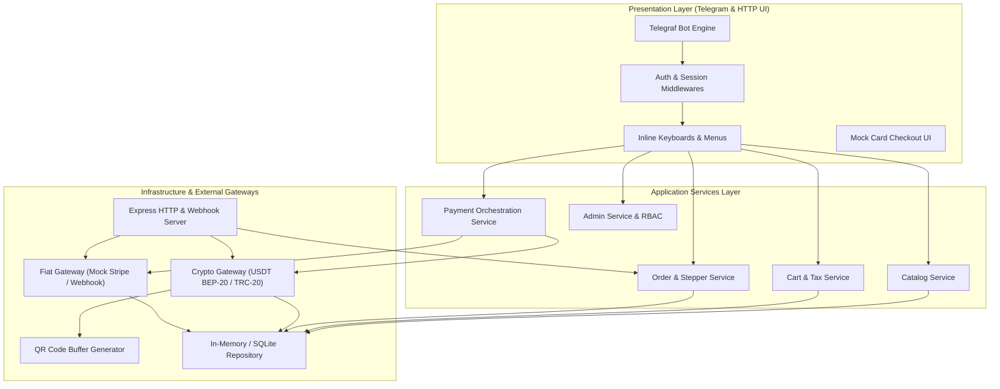
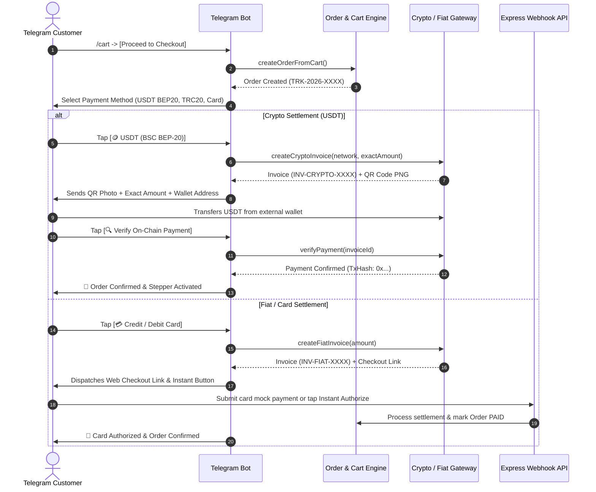

# 🤖 Telegram E-Commerce & Dual Crypto / Fiat Payment Bot

[](https://www.typescriptlang.org/)
[](https://nodejs.org/)
[](https://telegraf.js.org/)
[](https://vitest.dev/)
[](https://tether.to/)
[](LICENSE)

> Production-grade, enterprise-ready Telegram E-Commerce and Payment Bot built with **TypeScript**, **Telegraf v4**, **Express v5**, and **Clean Architecture**. Designed for seamless digital and physical product sales with automated **USDT (BEP-20 / TRC-20)** crypto settlement, dual mock fiat card gateway, live visual order fulfillment tracking steppers, and an administrative command center.

---

## 🌟 Executive Overview & Key Capabilities

- **Interactive Product Catalog:**
  - Multi-category hierarchy with icon badges, descriptions, and stock status indicators (`🟢 In Stock`, `🟡 Low Stock`, `🔴 Sold Out`).
  - Real-time inline quantity configurator (`[ ➖ ] [ Qty: 1 ] [ ➕ ]`) and direct "Add to Cart" actions.
  - Global catalog search via `/search <query>` matching names, descriptions, and metadata tags.
- **Dynamic Shopping Cart:**
  - Multi-item management with instant subtotal calculation, discount coupon codes (`WELCOME10`, `LABORX20`, `WEB3DEV`), and configurable tax calculation.
  - One-click cart clearing, quantity adjustments, and stock reservation guards.
- **Dual Payment Checkout Engine:**
  - **Crypto Payments (USDT on BEP-20 & TRC-20):**
    - Deterministic micro-decimal offset (e.g. `100.0024 USDT`) ensuring 100% collision-free transaction tracking on shared deposit wallets without deploying per-user smart contracts.
    - Automatic high-resolution QR code generation (EAL6+ compliant QR buffer sent as high-res photo in chat).
    - Destination wallets:
      - **BSC (BEP-20):** `0x0730236b443035c3434de32263594e6bd9ce3d94`
      - **TRON (TRC-20):** `TPPdHJZRFsdsu4YiqQfPkGH1L3UzwNx74N`
    - Instant on-chain verification trigger button and webhook integration.
  - **Fiat / Card Mock Checkout:**
    - Generates dynamic checkout session invoices (`INV-FIAT-XXXX`).
    - Responsive browser mock checkout UI (`/checkout/mock/:invoiceId`) and instant test settlement button.
- **Visual Order Fulfillment Stepper & Tracking:**
  - Unique human-readable tracking codes: `TRK-2026-XXXX`.
  - Visual status progress bar in Telegram:
    `[🟢 Confirmed] ➔ [🟢 Processing] ➔ [⚪ Shipped] ➔ [⚪ Delivered]`
  - Real-time customer order notifications upon courier dispatch and tracking number assignment.
- **Admin Executive Command Center (`/admin`):**
  - Live revenue analytics, order volume breakdown, and crypto vs. fiat settlement ratios.
  - Interactive order management: advance fulfillment steppers and assign carrier tracking numbers (DHL, FedEx, etc.).
  - Inventory audit and stock management.
  - Global broadcast engine (`/broadcast <message>`) to dispatch alerts to all registered bot users.
- **REST & Webhook Integration API:**
  - Production-ready Express server with `/health`, `/api/orders/:trackingCode`, `/api/webhooks/crypto`, and `/api/webhooks/fiat`.

---

## 📐 System Architecture

The project adheres strictly to **Clean Architecture** and **Hexagonal (Ports & Adapters)** design principles, separating domain logic from external transport layers:



---

## 🔄 Dual Payment & Checkout Sequence



---

## 🚀 Quickstart & Installation

### Prerequisites
- **Node.js:** v20.x or higher
- **npm:** v10.x or higher
- (Optional) **Docker & Docker Compose**

### 1. Clone & Install Dependencies
```bash
git clone https://github.com/anasAlShlah/telegram-crypto-sales-bot.git
cd telegram-crypto-sales-bot
npm install
```

### 2. Configure Environment Variables
Copy `.env.example` to `.env` and configure your credentials:
```bash
cp .env.example .env
```

| Variable | Description | Default / Example |
| :--- | :--- | :--- |
| `BOT_TOKEN` | Telegram Bot token from [@BotFather](https://t.me/botfather) | `YOUR_BOT_TOKEN` |
| `BOT_MODE` | Bot mode: `polling` for local dev, `webhook` for production | `polling` |
| `PORT` | HTTP Webhook & Health check port | `3000` |
| `USDT_BEP20_WALLET` | BSC Deposit Wallet (USDT BEP-20) | `0x0730236b443035c3434de32263594e6bd9ce3d94` |
| `USDT_TRC20_WALLET` | TRON Deposit Wallet (USDT TRC-20) | `TPPdHJZRFsdsu4YiqQfPkGH1L3UzwNx74N` |
| `ADMIN_TELEGRAM_IDS` | Comma-separated Admin Telegram User IDs | `123456789,987654321` |
| `TAX_RATE` | Store sales tax rate | `0.05` (5%) |
| `CRYPTO_PAYMENT_TIMEOUT_MINUTES` | Payment invoice countdown window | `60` |

### 3. Build & Run
```bash
# Compile TypeScript to JavaScript
npm run build

# Start production server
npm start

# Or start in hot-reload development mode
npm run dev
```

---

## 🧪 Comprehensive Test Suite

The project includes unit and integration tests powered by **Vitest**:
- **Cart & Pricing Engine:** Subtotal calculations, tax additions, promo coupons, stock constraints.
- **Catalog & Search:** Category filters, keyword matching, item card generation.
- **Payment Gateway:** USDT BEP-20 / TRC-20 routing, micro-offset calculations, QR PNG generation, simulated blockchain confirmations.
- **Order Management:** Tracking code formatting, inventory stock decrements, lifecycle stepper states.
- **Admin Control & RBAC:** Privilege verification, sales analytics, fulfillment dispatch.
- **HTTP & Webhooks:** Live server `/health` status, order tracking API, crypto/fiat webhook settlements, and mock card checkout HTML rendering.

```bash
# Run all tests
npm test
```

Test Results Output:
```
 Test Files  6 passed (6)
      Tests  29 passed (29)
   Duration  613ms
```

---

## 🐳 Docker Deployment

A multi-stage, hardened `Dockerfile` is provided for containerized production deployments.

### Using Docker Compose
```bash
# Build and start container in detached mode
docker compose up -d --build

# View real-time logs
docker compose logs -f

# Check health check status
curl http://localhost:3000/health
```

---

## 📡 REST & Webhook API Endpoints

| Method | Endpoint | Description |
| :--- | :--- | :--- |
| `GET` | `/health` | Service health status, uptime, and database summary metrics |
| `GET` | `/api/orders/:trackingCode` | Public order status and tracking stepper JSON |
| `POST` | `/api/webhooks/crypto` | Blockchain transaction confirmation listener (`{ invoiceId, txHash }`) |
| `POST` | `/api/webhooks/fiat` | Fiat mock payment confirmation listener (`{ invoiceId }`) |
| `GET` | `/checkout/mock/:invoiceId` | Interactive responsive HTML card payment test page |

---

## 👨‍💻 Engineering & Architecture Bio

**Anas Al Shlah (أنس الشلاح)**  
*Frontend & Mobile Team Lead | Senior Web3 & Offline-First Architect*  
- **Model:** Remote / Worldwide (Contract, Senior Full-Time, Lead Consulting)
- **GitHub:** [@anasAlShlah](https://github.com/anasAlShlah)
- **Email:** `anas.alshlah.dv@gmail.com`
- **Core Stacks:** Node.js, TypeScript, Angular, React Native, Soroban Smart Contracts, Stellar Ecosystem, Micro-Donations & Escrow Protocols.

---

## 📄 License
This project is licensed under the **MIT License**.
